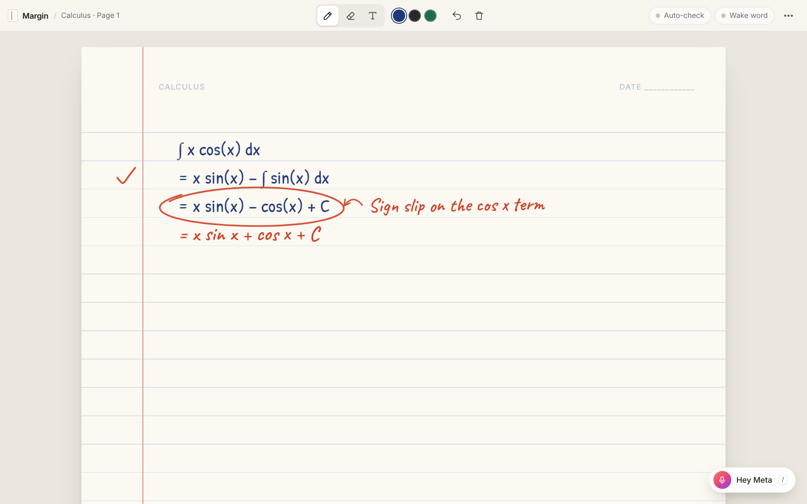

# Margin

Meta Global AI Developer Hackathon 2026. A calculus assistant that lives inside your notebook page.

You write your working with a pen. When you call it ("Hey Meta, help me with this integral",
or press `/`), it reads the page, checks every step with a computer algebra engine, and
**writes a hint in red-pencil handwriting next to the exact line that went wrong**. Ask again
(or tap the hint) and the hint gets more specific; at level 3 it writes a faint "ghost" of the
next line. Say "just give me the answer" and it writes out the rest of the working.

No chat box: everything the assistant says is ink on the page.

**The notebook:** a shelf of notebooks, pages with thumbnails, pressure-sensitive pen (Apple Pencil),
highlighter, lasso, movable text boxes, photos and PDF pages, pinch zoom, autosave, PNG/PDF export,
and it installs on the iPad home screen (Safari → Share → Add to Home Screen) and works offline.

**What Meta can do on the page:** hints (3 levels, then a faint "ghost" of the next line), check my work,
just give me the answer, tidy my writing into typed maths, and sketch the graph. Covers indefinite and
definite integrals and derivatives (product rule, chain rule). Muse Spark 1.3 runs as a tool-calling
agent; every piece of maths it writes comes from the SymPy referee.



## How it works

```
pen strokes / typed lines ──► Muse Spark 1.3 reads the page into math lines
                               │
                               ▼
                        SymPy referee (server/checker.py)
                        each line must equal the last; antiderivatives compared by
                        differentiating; diagnoses sign slips, missing constant
                        factors, power-rule slips, "differentiated instead", missing + C
                               │
                               ▼
              Muse Spark 1.3 phrases the verdict as a ≤8-word hint (never decides correctness)
                               │
                               ▼
              page writes circle / note / tick / underline / ghost / write annotations
```

- Meta models: **Muse Spark 1.3** (page reading, intent, hint wording), **Muse Voice Transcribe**
  (voice commands when browser Web Speech is missing or fails).
- API contract between page and server: [docs/CONTRACT.md](docs/CONTRACT.md).
- Optional decision router (Muse Glimmer, off by default): one short JSON call picks the tool and
  hint level, with Spark as the fallback. Data builder, eval and fine-tuning: [docs/ROUTER.md](docs/ROUTER.md).

## Run it

One command: `./start.sh` (Mac/Linux) or double-click `start.bat` (Windows), then open http://localhost:8000.
Put your `MODEL_API_KEY` in `.env` to turn on handwriting reading.

Manual:

```bash
python3 -m venv .venv && .venv/bin/pip install -r requirements.txt
cp .env.example .env        # put your MODEL_API_KEY from https://dev.meta.ai in it
.venv/bin/uvicorn server.app:app --reload
# open http://localhost:8000  (⋯ menu → "Try the demo problem", then press / → Help me)
.venv/bin/pytest -q         # offline, no network
```

Without `MODEL_API_KEY` it runs in **offline mode**: typed lines (T tool) are checked and hints
come from rules; handwriting can only be read with the key.

## Put it online (free https, needed for voice on iPad)

Hugging Face Spaces: create a Space with the **Docker** SDK, push this repo to it, and add
`MODEL_API_KEY` under Settings → Variables and secrets (as a secret). The Dockerfile serves on port 7860.
Render also works: New Web Service → this repo → Docker, and add `MODEL_API_KEY` as an environment variable.

## Limitations (MVP)

- Lives in its own web notebook, not inside GoodNotes/Notability (no plugin APIs). OneNote add-in
  or a Xournal++ plugin are the realistic routes into a real app.
- The live Meta API path (page reading, hint wording, transcription) has not been run yet: needs a key.
- Maths scope: first-year integrals and derivatives; quotient-rule mistakes get only a generic hint.
- Voice wake word needs Chrome; not tested on a real iPad / Apple Pencil. Notebooks are saved in the browser on one device (no accounts or sync).
