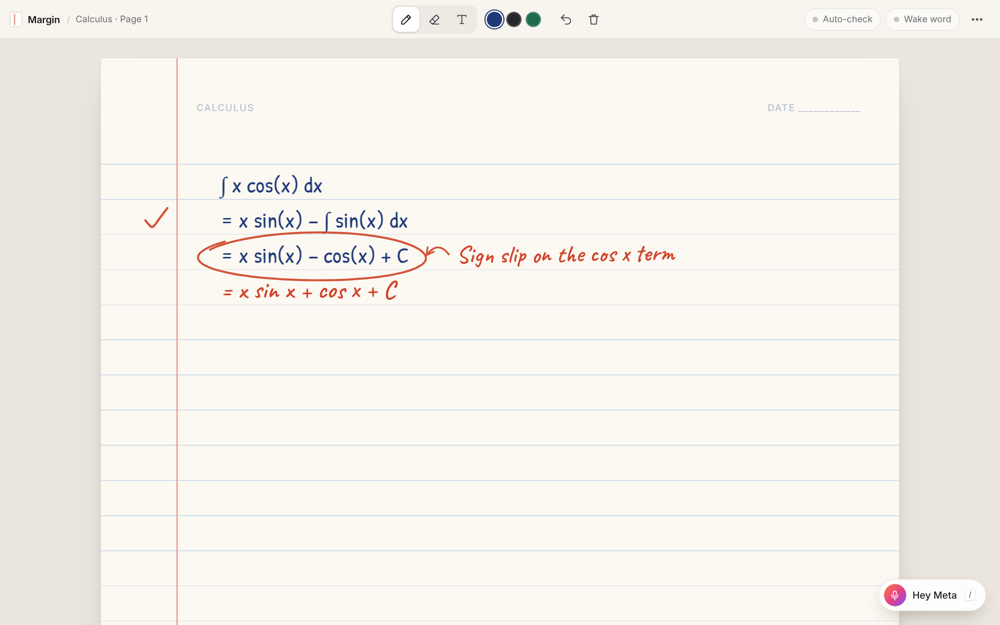

# Margin

Meta Global AI Developer Hackathon 2026. A calculus assistant that lives inside your notebook page.

You write your working with a pen. When you call it ("Hey Meta, help me with this integral",
or press `/`), it reads the page, checks every step with a computer algebra engine, and
**writes a hint in red-pencil handwriting next to the exact line that went wrong**. Ask again
(or tap the hint) and the hint gets more specific; at level 3 it writes a faint "ghost" of the
next line. Ask "what's next?" for a single verified step, "why does this work?" for the underlying
rule and formula, or "just give me the answer" to write out the rest of the working.

No chat box: everything the assistant says is real ink on the page.

**The notebook:** a shelf of notebooks, pages with thumbnails, ruled/grid/blank paper, Daylight/Sepia/Night themes,
pressure-sensitive pen (Apple Pencil), highlighter, stroke- and segment-level eraser, scratch-out gesture (scribble
side-to-side to erase ink or typed words), lasso (move, recolour, delete, or adopt Meta's ink), movable text boxes,
photos and multi-page PDF worksheets, pinch zoom, 400ms local autosave + optional cloud sync, PNG/PDF export,
and full PWA offline support on iPad (`Safari → Share → Add to Home Screen`).

**What Meta can do on the page:**
- **Progressive hints (`give_hint`)**: 3 levels (Level 1 gentle nudge, Level 2 names the rule/mistake, Level 3 writes a faint "ghost" of the corrected step).
- **Check my work (`check_steps` & `differentiate_check`)**: ticks every correct step, circles the first wrong line with a margin note, and underlines downstream lines that inherit the error.
- **What's next? (`next_step`)**: writes *only* the single next step after your last correct line—verified by SymPy before it touches the page.
- **Why does this work? (`explain_rule`)**: writes a 3-line rule + LaTeX formula explanation beside the latest step or mistake.
- **Just give me the answer (`finish_answer`)**: writes out the remaining verified steps as a preview with **Accept / Redo / Discard** controls.
- **Tidy my writing (`typeset_lines`)**: places neat typeset mathematics (`STIX Two Text` & LaTeX) beside your handwriting.
- **Sketch the graph (`sketch_graph`)**: draws an inline curve plot (with shaded areas for definite integrals or derivative/antiderivative overlays).

**Tangible AI ink:** Meta writes using real vector pen strokes (ported from Writey's handwriting and TeX-math layout engine). Once written, Meta's marks bake into the notebook as real ink (`by: 'meta'`)—you can erase them, scratch them out, lasso and move them, recolour them (**Pencil Red**, **Graphite**, **Magenta**, or **My pen colour**), tap **"Make it mine"** to adopt a step into your own working, or keep writing below a hint so older hints automatically fade out of your way. Pause writing for 2 seconds and context-aware suggestion chips appear right beside your pen.



## How it works

```
pen strokes / typed lines ──► Muse Spark 1.3 reads the page into math lines (or uses typed lines)
                                │
                                ▼
                         SymPy referee (server/checker.py & server/explain.py)
                         each line must equal the last; antiderivatives compared by
                         differentiating; diagnoses 14+ mistake patterns (sign slips,
                         missing constant factors, product/chain/power rule slips,
                         by-parts errors, swapped/dropped limits, "differentiated instead",
                         missing + C) and generates verified next steps & rule formulas
                                │
                                ▼
               Optional Decision Router (Muse Glimmer, server/router.py)
               ──► Muse Spark 1.3 tool-calling agent (server/skills.py)
               ──► phrases the verdict as a ≤8-word hint (never decides correctness)
                                │
                                ▼
               Writey stroke engine (web/handwriting.js + web/assistant.js)
               ──► animates circle / note / tick / underline / ghost / write / typeset / graph
```

- **Meta models:**
  - **Muse Spark 1.3 (`muse-spark-1.3`)**: multimodal page reading (vision OCR into math lines), tool-calling agent loop (`server/skills.py`), and natural hint/explanation phrasing (`server/meta_client.py`). It **never** decides mathematical correctness—SymPy is the sole referee.
  - **Muse Voice Transcribe (`muse-voice-transcribe-1.0`)**: powers live and recorded voice dictation alongside browser Web Speech API, plus continuous `"Hey Meta"` wake-word listening.
  - **Muse Glimmer (`muse-glimmer-30b`, optional decision router)**: ultra-fast single-call JSON intent & hint-level router in front of Muse Spark ([docs/ROUTER.md](docs/ROUTER.md)).
- **Live voice over WebSockets + Smart WAV Fallback:**
  - The page streams 24 kHz mono PCM microphone audio to `/ws/voice` (`server/realtime.py`), which relays frames to Meta's realtime ASR (`wss://api.meta.ai/v1/asr/realtime`, keeping `MODEL_API_KEY` on the server) so words appear in the command bar as you speak.
  - On serverless hosts that cannot hold WebSockets open (e.g., Vercel), or if WebSockets fail, the page records audio, trims leading/trailing silence, normalizes quiet laptop mics (up to 30× gain), converts to 16 kHz mono WAV in the browser (`web/voice.js`), and posts to `/api/transcribe`.
- **Cloud Sync, Hardened Auth & Anti-Overload Database (`server/db.py`, `server/auth.py`):**
  - Notebooks work 100% offline in browser `IndexedDB` (`web/store.js`), and optionally sync across devices when signed in.
  - Dual-dialect database engine supporting **PostgreSQL 16** (with Row-Level Security) and **SQLite (WAL mode)**.
  - Built-in anti-overload optimizations: SHA-256 content-hash deduplication (`content_hash`), pen coordinate quantization (`0.1px` spatial, `1%` pressure), zlib binary compression (`75–85%` storage reduction with `5 MiB` zip-bomb guards), content-addressable image blobs (`media_blobs`) with `50 MiB` per-user quotas, and a lightweight AI interaction ledger (`ai_interactions`) with semantic caching.
  - Enterprise-grade security (`server/auth.py`): memory-hard `scrypt` password hashing, timing-attack dummy verification, 5-attempt brute-force lockout, 15-minute `HS256` access JWTs, rotating 7-day refresh tokens with compromised token-family reuse detection, and active device session management.
  - Independent sliding-window rate limiters and state-machine **circuit breakers** (`closed → open → half_open`) across Meta API calls, the decision router, and the database.
- **Documentation:**
  - Page ↔ Server API Contract: [docs/CONTRACT.md](docs/CONTRACT.md)
  - Decision Router, Dataset Builder & Evaluation Harness: [docs/ROUTER.md](docs/ROUTER.md)
  - Database, Security, Session Manager & Deployment Architecture: [docs/DATABASE_AND_DEPLOYMENT.md](docs/DATABASE_AND_DEPLOYMENT.md)

## Run it

One command: `./start.sh` (Mac/Linux) or double-click `start.bat` (Windows), then open http://localhost:8000.
Put your `MODEL_API_KEY` in `.env` to turn on handwriting reading and live Meta voice.

Manual setup:

```bash
python3 -m venv .venv && .venv/bin/pip install -r requirements.txt
cp .env.example .env        # put your MODEL_API_KEY from https://dev.meta.ai in it
.venv/bin/uvicorn server.app:app --reload
# open http://localhost:8000  (⋯ menu → "Try the demo problem", then press / → Help me)
.venv/bin/pytest -q         # 343 tests, runs 100% offline with no network required
```

Without `MODEL_API_KEY` it runs in **offline mode**: typed lines (`T` tool) are checked by SymPy, hints and explanations come from deterministic templates, and notebooks save locally and to SQLite/PostgreSQL.

## Use Margin from other agent apps (MCP server)

`server/mcp_server.py` exposes Margin's verified calculus referee over the **Model Context Protocol (MCP)**, so Claude Desktop, Claude Code, Cursor, or any MCP client can check calculus working without hallucinating math steps.

| Tool | What it returns | Needs `MODEL_API_KEY`? |
|------|-----------------|------------------------|
| `check_steps` | status of every line, the first wrong line and a note on the mistake | no |
| `give_hint` | a hint on the first wrong line (levels 1–2 never reveal the answer) | no (Spark words it when set) |
| `next_step` | one next step, checked by SymPy before it is returned | no |
| `explain_rule` | why the step works: rule, formula (plain + LaTeX), and how it applies | no (Spark words it when set) |
| `finish_answer` | the remaining verified steps and the answer | no |
| `typeset_lines` | each line as neat unicode text and LaTeX | no |
| `sketch_graph` | graph points for the function (and the antiderivative/shaded area) | no |
| `differentiate_check` | differentiates an antiderivative to check it against the integrand | no |
| `read_handwriting` | the lines read from a photo of a page (Muse Spark vision) | yes |
| `ask_margin` | Margin's own Muse Spark agent chains the tools for a request like "help me" | yes (keywords without it) |

Lines are a list of strings, one step each, e.g. `["∫ 2x cos(x^2) dx", "= sin(x^2) + C"]`.

```bash
.venv/bin/pip install -r requirements-mcp.txt
.venv/bin/python -m server.mcp_server              # stdio
.venv/bin/python -m server.mcp_server --http 8765  # streamable HTTP at http://127.0.0.1:8765/mcp
```

Claude Desktop (`Settings → Developer → Edit Config`), with your own path:

```json
{
  "mcpServers": {
    "margin": {
      "command": "/path/to/METAhackathon/.venv/bin/python",
      "args": ["-m", "server.mcp_server"],
      "cwd": "/path/to/METAhackathon"
    }
  }
}
```

Claude Code:
```bash
claude mcp add margin -- /path/to/METAhackathon/.venv/bin/python -m server.mcp_server
```

## Deploy it (HTTPS + Cloud Database)

Margin supports three production deployment architectures out of the box (see [docs/DATABASE_AND_DEPLOYMENT.md](docs/DATABASE_AND_DEPLOYMENT.md) for step-by-step playbooks):

1. **Railway (`railway.json` + `Dockerfile`)**: 1-click container deployment linked to Railway PostgreSQL (`DATABASE_PRIVATE_URL`) with persistent WebSockets (`/ws/voice`) and `/api/health` monitoring.
2. **Docker Compose on a VPS (`docker-compose.yml`)**: runs `margin-app` alongside `postgres:16-alpine` (auto-initialized via `docker/postgres/init.sql` with persistent volume `margin_pgdata`).
3. **Vercel + Supabase (`vercel.json` + `api/index.py`)**: zero-ops serverless FastAPI connected to Supabase PostgreSQL via Supavisor Transaction Pooler (`:6543`, automatic `prepare_threshold=None` and `sslmode=require`).
4. **Hugging Face Spaces / Render**: push the repo with the **Docker** SDK and set `MODEL_API_KEY` in environment secrets.

## Limitations

- Lives in its own web/PWA notebook rather than inside GoodNotes or Notability (which have no public plugin APIs). A OneNote add-in or Xournal++ plugin are the natural native-app extensions.
- Maths scope focuses on first-year single-variable calculus (indefinite and definite integrals, derivatives via product/chain/power/trig/exponential rules); quotient-rule mistakes currently receive a general step hint.

## Credits

- **[Writey](https://github.com/lagoonitself/writey)** (MIT): Meta's handwriting engine and maths
  layout are ported from Writey's `packages/inkscript` (glyph data, seeded jitter and `handLine`,
  `textBox` / `writeText`, the LaTeX parser and `layoutMath`: fractions, scripts, ∫ with limits, √,
  sized brackets; pen timing). Plain-JS port in `web/vendor/writey/` with its licence. The
  Accept / Redo / Discard preview for written answers is Writey's idea too.
- **EMS Allure** (SIL Open Font License 1.1, `web/vendor/writey/OFL.txt`) and the **Hershey fonts**
  (via hersheytext, MIT): the glyph stroke data Meta writes with.
- **[PenEcho](https://github.com/erickong/penecho)**: inspired the pause suggestions (chips by the pen
  when you stop writing). No PenEcho code is used.
